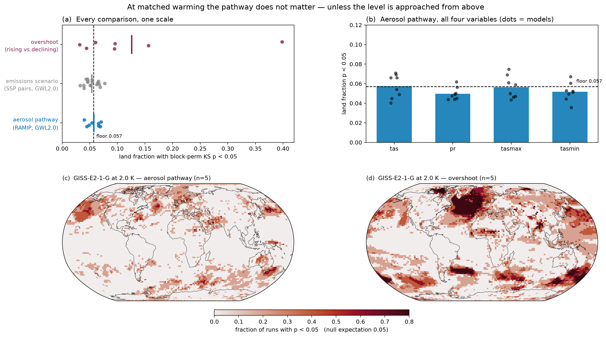
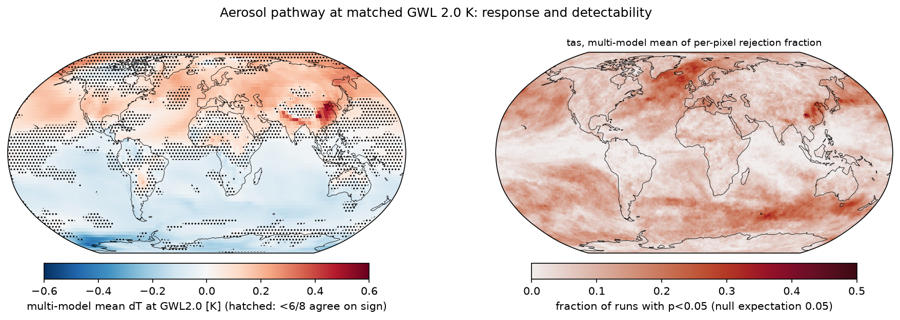
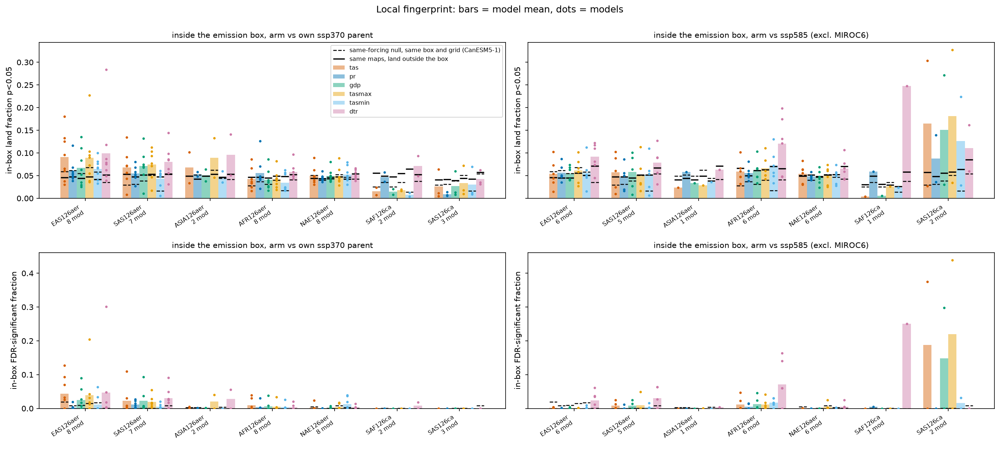
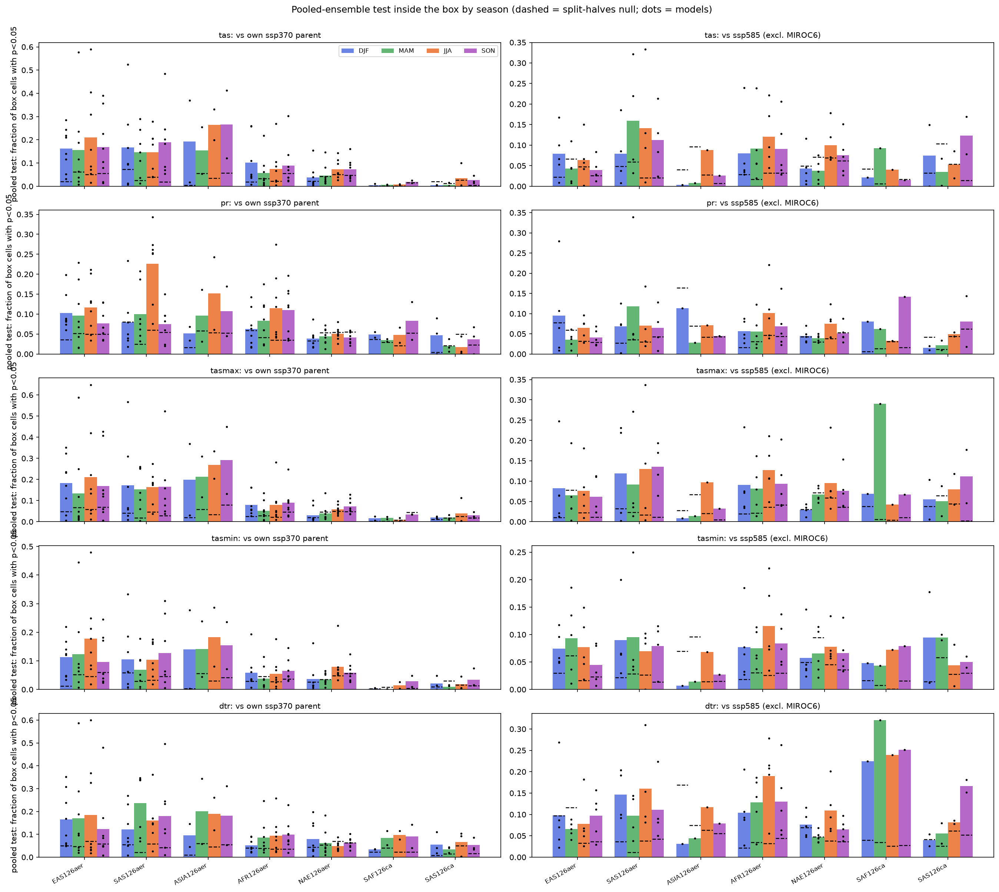
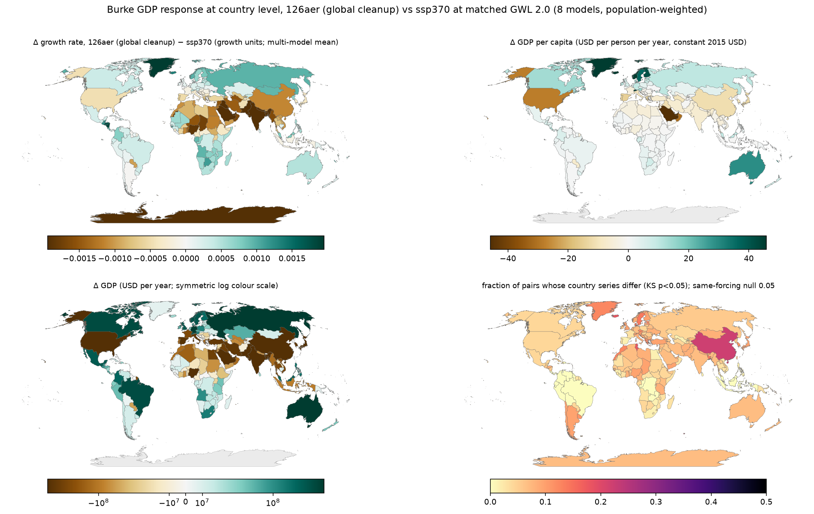
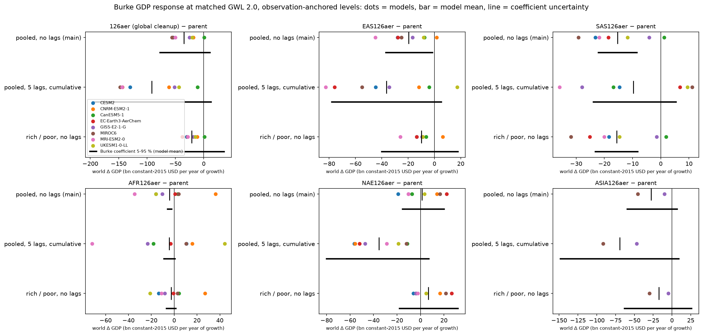
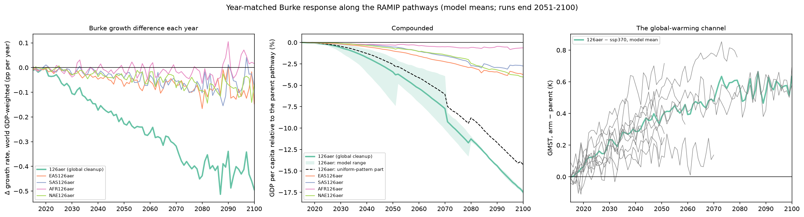

# Summer Project: Path Independence at Global Warming Levels — Technical Documentation

@Milind

## Summary

At a fixed global warming level, local monthly climate is statistically indistinguishable between aerosol pathways and between emissions scenarios, and differs only when the level is approached from above (overshoot). The validation sharpens that statement: the per-pixel test cannot see shifts below about 1 K, and the regional aerosol cleanups do leave a small, real, local difference at 2 °C (0.1–0.2 K and 2–4 % of precipitation inside the cleanup region) that becomes detectable once the ensemble is pooled.

| # | Experiment | Comparison at GWL 2.0 | Raw land fraction (floor 0.057) | Wilks FDR fraction | Verdict |
| --- | --- | --- | --- | --- | --- |
| 1 | Global aerosol cleanup | ssp370 vs ssp370-126aer, 8 models, 6–10 pairs each | tas 0.058, pr 0.050, tasmax 0.056, tasmin 0.052, gdp 0.054 | 0.0022 | Indistinguishable at the pixel level |
| 2 | East-Asia cleanup | ssp370 vs ssp370-EAS126aer, 8 models, 67 pairs | 0.048 | 0.0009 | Indistinguishable globally; local fingerprint over East Asia (in-box 0.091 vs 0.046 outside; in-box FDR 0.044 vs null 0.019) |
| 3 | Regional arms | EAS, SAS, AFR, NAE, ASIA, SAF-ca, SAS-ca vs own ssp370 parent and vs ssp585; six variables including tasmax, tasmin and the diurnal range; whole windows and by season | 0.039–0.065 | ≤ 0.005 | Indistinguishable globally in every variable and season; a local daytime fingerprint for East and South Asia (tasmax and the diurnal range, in-box FDR 0.02–0.05 against nulls of at most 0.015), Africa marginal, the rest none; with the ensemble pooled the fingerprint has a season (South-Asian monsoon rain in JJA, haze-season temperature along the Indo-Gangetic plain in DJF, eastern China year-round) |
| 4 | ssp585 as anchor | ssp585 vs EAS126aer and vs 126aer, 6 models | 0.047 and 0.056 | 0.0008 and 0.0013 | Indistinguishable; MIROC6 excluded (RAMIP MIROC6 is a different configuration) |
| 5 | Emissions scenario | ssp126, ssp245, ssp585 in pairs, 7 models | 0.054 (per pair 0.033–0.077) | 0.0012 | Indistinguishable |
| 6 | Overshoot | ssp534-over declining vs rising branch, 4 models | 0.126 (MRI-ESM2-0 0.398 and GISS-E2-1-G 0.096 at 2.0 K) | 0.078 | Path-dependent; rests on few members |
| 7 | Burke GDP response | Growth response per cell (7), per country (7b), and revisited with Burke's own regression and uncertainty (7c, `gdp/`): matched 2 °C and along the pathway | Matched 2 °C, global cleanup: −35 ± 22 bn US$ per year of growth (model sd; Burke's coefficient 90 % range −78 to +12), China −16, India −9, United States −7 bn; along the pathway −3.4 ± 1.6 % of GDP per capita by 2050, three quarters of it from the cleanup's extra global warming | — | A loss where people live, real against internal variability; its size is bounded by Burke's regression, not by the models |

The validation adds four findings that change how rows 1–4 should be read:

- **Detection limit.** With one pair of 10-year windows the per-pixel test rejects half the land cells only for an imposed shift of about 1 K in monthly temperature or 25 % in monthly precipitation. The regional cleanups change box-mean temperature by at most 0.25 K and precipitation by at most 4 %, so "indistinguishable" means "below this test's resolution", not "identical".
- **The difference exists.** Pooling 7–10 members per side makes the same test reject 40–50 % of the cleanup box (in-box FDR 0.5–0.7) in MRI-ESM2-0 and MIROC6, against a null below 11 %; a test on the box-mean series finds East-Asia and Asia temperature and Africa, Asia and South-Asia precipitation different at 4–8 times their null.
- **Timing.** A hot model reaches 2 °C before the aerosol pathways have separated (CanESM5-1's matched decade ends in 2027), a cool one after (MIROC6: 2065). The local response grows with the matched-window year, so multi-model means mix the two regimes.
- **FDR resolution.** With 999 permutation draws the FDR test cannot flag fewer than 108 land cells, so "FDR ≈ 0" means "fewer than 108 cells at the permutation floor".

The defensible statement is: at a fixed global warming level, pathway differences of the RAMIP and ScenarioMIP kind leave local monthly climate indistinguishable at the pixel level and shift regional means by at most about 0.2 K and 4 %, with the largest and most consistent effects inside the region whose emissions changed; overshoot is the one pathway difference the pixel test sees directly.



All numbers in this document come from the cached outputs under `summer_data/aux/` and the audit outputs in `bcd_me/path_independence/method/audit/out/`; the Reproduction section says how to regenerate each one.

**All work, in order.** Each row is detailed in the sections that follow.

| Stage | Work | Where it lives |
| --- | --- | --- |
| 1 | Repos cloned; CMIP6 monthly tas downloaded for 5 models (84 members); GWL time series and crossing years; two reproductions of BCD-ME Fig. 2 (simplified, and a faithful port of the authors' notebook) | `bcd_me/code/` local additions, `path_independence/earlier/`; `aux/gwl_ann_CMIP6_ALLEXPs_ALLRUNs_1860-2090_fromAmon.nc`, `aux/bcdme_gwl061to2_change_ERA5.nc` |
| 2 | Block-permutation KS test built and size-verified; first RAMIP comparison year-matched (2041–2050), then re-done at matched GWL 2.0 | `method/ks_block_permutation`, `method/ks_blockperm_diagnostics`, `pipeline/ks_path_independence_ramip_gwl` |
| 3 | Data layer (GMST, crossings, AR6 regional means); ScenarioMIP download; `gwl_timeseries.zarr`; scenario and overshoot KS; RAMIP at 1.5–3.0 K; Burke GDP response | `pipeline/ramip_data_layer`, `scenariomip_download`, `build_data_product`, `ks_location_scenarios`, `ramip_impacts_gdp` |
| 4 | ESMF environment; common 1° grid; `gdp` variable; East-Asia arm; Wilks FDR; summary tables 1–5 and figures | `pipeline/ks_gwl_1deg`, `ramip_summary`, `project_figure`, `story_figures` |
| 5 | ssp585 as anchor for the East-Asia and global arms; MIROC6 configuration diagnosis | `regional/ks_regional_vs_ssp585`, `DATA.md` §5 |
| 6 | Python environment rebuilt; six more regional arms with two anchors and the in-box test; FDR bug fixed; method audit (power, effect sizes, pooled-ensemble test); this document | `regional/ks_regional_arms`, `run/run_regional_arms_array.sbatch`, `AUDIT.md`, `method/audit/` |
| 7 | ssp585 tasmax/tasmin downloaded; tasmax, tasmin and the diurnal range added to the regional arms against both anchors; the arms by season with a pooled in-box test; the Burke GDP response at country level with population weights and World Bank GDP; figures and results reorganised into per-experiment folders | run/run\_download\_ssp585\_tmax.sbatch, regional/ks\_regional\_arms (second pass), regional/ks\_regional\_arms\_seasonal, pipeline/ramip\_impacts\_gdp\_country, run/reorganize\_outputs.py, run/patch\_output\_paths.py |
| 8 | GDP revisited: Burke's regressions re-estimated from his replication package with the 1000-draw bootstrap, observation-anchored temperature levels, Δg tested against its own same-forcing spread, three money framings, and a year-matched, compounded pathway experiment; nothing in `pipeline/` changed | `method/audit/gdp_check.py`, `gdp/burke.py`, `gdp/country_tas.py`, `gdp/ramip_gdp_burke`, `gdp/ramip_gdp_pathway`, `gdp/run_gdp.sbatch` |

## Question and design

Impact studies increasingly index climate by global warming level (GWL), as in "the world at +2 °C", on the assumption that local climate at a level does not depend on how the level was reached. This project tests that assumption on CMIP6-class simulations, pixel by pixel, for four kinds of pathway difference.

**Design.** Every run is sampled in its own 10-year window (120 months) ending in the year its 10-year running-mean global-mean temperature first reaches the level, so two runs are compared at the same global temperature even when they get there in different decades. At each grid cell the two 120-month samples are compared with a block-permutation Kolmogorov–Smirnov (KS) test (12-month blocks, 999 draws). A rejection at p < 0.05 means the monthly distribution at that cell differs between the two pathways at the same global warming.

| Family | Pair compared at the same GWL | Data | What differs between the pathways |
| --- | --- | --- | --- |
| Aerosol cleanup, global | ssp370 vs ssp370-126aer | RAMIP, 8 models | Aerosol emissions only (all species cut to SSP1-2.6 levels); greenhouse gases identical |
| Aerosol cleanup, regional | ssp370 vs ssp370-EAS126aer, -SAS126aer, -AFR126aer, -NAE126aer, -ASIA126aer and the carbonaceous-only -SAF126ca, -SAS126ca; the same arms vs ssp585 | RAMIP, 2–8 models per arm | Aerosols in one region only; vs ssp585 also the greenhouse-gas pathway |
| Emissions scenario | ssp126, ssp245 and ssp585 in pairs | ScenarioMIP, 7 models | Whole forcing mix and rate of warming |
| Direction of travel | Declining branch of ssp534-over vs the rising branch | ScenarioMIP, 4 models | Warming through the level vs cooling back through it |

**How a result is read.** Each comparison yields three numbers. The *raw land fraction* is the share of land cells with p < 0.05, averaged over run pairs; under identical forcing the test rejects 0.057 of land (45 CanESM5-1 member pairs), so 0.057 means "indistinguishable from internal variability", not zero. The *Wilks FDR fraction* is the share of land cells still significant after Benjamini–Hochberg false-discovery control at α\_FDR = 0.2, whose null expectation is about 0. For the regional arms both are also computed *inside the arm's emission box*, against a same-forcing null for that box. The validation section adds the fourth number the test itself cannot give: the size of the difference, as the box-mean change in temperature and precipitation.

## Data

All data lives under `summer_data/` → `/burg/glab/users/mck2199/summer_data`: `raw/` holds downloads, `aux/` every derived product (all cached, so deleting it costs compute, not information), `figures/` the plots. Every notebook resolves these paths through `get_params()` in `bcd_me/code/funcs_support.py`, which reads `dir_list.csv` from the working directory; `path_independence/` and each of its subfolders carry a symlink to `../code/dir_list.csv`, which is why every job runs from `path_independence/`.

### Sources

| Source | How obtained | Location in `raw/` | Contents |
| --- | --- | --- | --- |
| RAMIP (Wilcox et al. 2023) | Pangeo / ESGF transfer | `ramip/{model}/` | 9 models; monthly `tas`, `pr`, `tasmax`, `tasmin`; `ssp370` (CESM2: `ssp370-LE`), `ssp370-126aer`, the regional arms `EAS`, `SAS`, `AFR`, `NAE`, `ASIA` (126aer) and the carbonaceous-only `SAF126ca`, `SAS126ca` |
| ScenarioMIP (CMIP6) | `pipeline/scenariomip_download.ipynb` from the Pangeo GCS catalogue | `scenariomip/{model}/` (31 GB) | `tas` + `pr` for `ssp126`, `ssp245`, `ssp585`, `ssp534-over`, plus `historical` for the 1850–1900 baselines |
| CMIP6 monthly `tas` | `climate-downloads/download_multi_runs.py` | `{model}/` (11 GB) | 5 models × historical + 4 SSPs, ≤ 5 members, for the GWL time series of Experiment 0 |
| BCD-ME (Schwarzwald et al.) | Earthmover Arraylake `ClimateUncertaintyLab/bcd_me_qdm` (needs `ARRAYLAKE_TOKEN`) | not stored; extracts in `aux/` | Bias-corrected, downscaled daily temperature indexed by GWL, for the Fig. 2 reproduction |

### RAMIP members on disk, by experiment

Tier-1 runs cover 2015–2051; the last column gives the extensions some groups ran. A model enters a comparison only where both sides have a member that reaches the level inside its data.

| Model | ssp370 | 126aer | EAS | SAS | AFR | NAE | ASIA | SAF-ca | SAS-ca | Last year |
| --- | --- | --- | --- | --- | --- | --- | --- | --- | --- | --- |
| CanESM5-1 | 10 | 10 | 10 | 10 | 10 | 10 | – | – | – | 2051 |
| CESM2 (`ssp370-LE`) | 10 | 10 | 10 | 10 | 10 | 10 | – | – | – | 2079 (parent 2100) |
| CNRM-ESM2-1 | 10 | 10 | 10 | 10 | 10 | 10 | 10 | 10 | 10 | 2051 (parent 2100) |
| EC-Earth3-AerChem | 10 | 10 | 10 | 10 | 10 | 9 | – | – | – | 2051 |
| GISS-E2-1-G | 10 | 10 | 10 | 10 | 10 | 10 | 10 | 9 | 9 | 2051 (126aer, AFR: 2070) |
| MIROC6 | 10 | 10 | 10 | 10 | 10 | 10 | 6 | 1 | 2 | 2100 |
| MRI-ESM2-0 | 10 | 10 | 10 | 10 | 10 | 10 | – | – | – | 2051 (parent 2100) |
| NorESM2-LM | 7 | 10 | 9 | 9 | 9 | 10 | – | – | – | 2059–2064 |
| UKESM1-0-LL | 10 | 10 | 10 | 9 | 10 | 10 | – | – | – | 2085–2100 (by member) |

ScenarioMIP members (`tas` + `pr`): CanESM5 10/10/5/10, CESM2 3/3/–/3, CNRM-ESM2-1 5/10/5/5, GISS-E2-1-G 10/10/10/10, MIROC6 10/10/1/10, MRI-ESM2-0 5/10/1/6, NorESM2-LM –/7/–/1, UKESM1-0-LL 10/10/5/5 for `ssp126` / `ssp245` / `ssp534-over` / `ssp585`. CanESM5 stands in for CanESM5-1 wherever RAMIP and ScenarioMIP are paired.

### The data product: `aux/gwl_timeseries.zarr`

One zarr v3 store with every experiment of both archives on shared coordinates, written by `pipeline/build_data_product.ipynb`; the `ks` group by `pipeline/ks_gwl_1deg.ipynb`, `ks_vs_ssp585` by `regional/ks_regional_vs_ssp585.ipynb`.

| Group | Variables | Dimensions |
| --- | --- | --- |
| `gmst` | `gmst_anom` (K vs the model's own 1850–1900 `historical` mean), `run_id`, `collection` | model 10 × exp 15 × member 10 × year 86 |
| `gwl` | `window_end` (last year of the first 10-yr window reaching the level), `down_end` (declining-branch window within 0.1 K, overshoot only), `peak` | model 10 × exp 15 × member 10 × gwl 4 (1.5, 2.0, 2.5, 3.0) |
| `regional` | `tas`, `pr`, `tasmax`, `tasmin` annual means over 46 AR6 land regions + global land (region −1) | model × exp × member × year 86 × region 47 |
| `ks` | `p_blockperm`, `run_id` for the global and East-Asia cleanup arms | comparison 2 × var 5 × model 8 × pair 10 × lat 180 × lon 360 |
| `ks_vs_ssp585` | the same for ssp585 vs the East-Asia and global arms | comparison 2 × var 3 × model 7 × pair 10 × 1° |
| `ks_regional_arms` | `p_blockperm`, `pair_id` for the seven regional arms vs own parent (`370`) and vs ssp585 (`585`), six variables incl. `tasmax`, `tasmin`, `dtr`; NaN where a combination does not exist (11 GB dense, written cache by cache) | anchor 2 × arm 7 × var 6 × model 9 × pair 10 × 1° |
| `burke_country` | `dT`, `dg`, `dg_pop2030`, `p`, `run_id`, with country coordinates `name`, `gdp_pc`, `gdp`, `pop_wb` | arm 8 × model 8 × pair 10 × country 228 |

Three traps when slicing it: `member` is a lexically sorted index, not a label (`member=0` is `r10i1p1f1` in MIROC6; look the run up in `run_id`); the array is sparse (36.6 % of the `gmst` grid is populated; check `run_id != ''`); and CanESM5-1 borrows its baseline from CanESM5, EC-Earth3-AerChem has no ScenarioMIP data, `tasmax`/`tasmin` are RAMIP-only.

### Other outputs in `aux/`

| Path | What |
| --- | --- |
| `data_layer/` | Tidy intermediates: GMST CSVs, GWL crossings, ScenarioMIP inventory, `regional/{var}_{model}.nc`; `population_1deg.nc` (GHS-POP 2020 and 2030 summed to the 1° grid) and `worldbank_gdp_pop.csv` (GDP, GDP per capita, population, 2019) |
| `diagnostics/ramip_gwl/` | `baseline_1850_1900.csv`, `gwl2.0_windows.csv`; native-grid KS maps `ks/`, `ks_pr/`, `ks_tasmax/`, `ks_tasmin/`; 1° maps `ks_1deg/`; land-fraction and FDR CSVs; `wilks_fdr_families.csv` |
| `diagnostics/ks_scenarios/` | 104 files: SSP pairs, overshoot, RAMIP at 1.5–3.0 K, with `land_fractions.csv` |
| `diagnostics/ks_blockperm_enspairs/CanESM5-1.nc` | 45 same-forcing member pairs: the null calibration (the 0.057 floor) |
| `diagnostics/regional_vs_ssp585/` | ssp585 vs East-Asia and global arms: `{cmp}_{var}_{model}.nc`, `land_fractions_{eas,glob}.csv` |
| `diagnostics/regional_arms/` | Seven regional arms × two anchors × six variables (`tas`, `pr`, `gdp`, `tasmax`, `tasmin`, `dtr`): `{anchor}_{arm}_{var}_{model}.nc`, `land_fractions_global.csv`, `land_fractions_box.csv`, `box_summary.csv`, and the 1° same-forcing nulls `null_1deg_{var}.nc` |
| `diagnostics/regional_arms_seasonal/` | The same arms by season: `p_blockperm(season, pair, lat, lon)`, `d_box(season, pair)`, `p_pooled(season, lat, lon)`, `p_pooled_null` per file; `null_1deg_seasonal_{var}.nc`; `seasonal_summary.csv`, `seasonal_by_model.csv` |
| `diagnostics/impacts/` | Per cell: `burke_gwl2.0.nc`, `burke_regional_gwl2.0.csv`; per country: `burke_country_pairs.csv`, `_null.csv`, `_summary.csv`, `_by_model.csv`, `_totals.csv` |
| `diagnostics/earlier/` | Outputs of the superseded `earlier/` notebooks (year-matched RAMIP, empirical null, first p-value maps) |
| `summary/table1–5*.csv` | Reporting tables (members, GWL crossings, land fractions by variable, families, regional response) |
| `gwl_ann_CMIP6_ALLEXPs_ALLRUNs_1860-2090_fromAmon.nc`, `bcdme_gwl061to2_change_ERA5.nc` | Experiment 0: GWL time series (5 models, 84 members) and the BCD-ME change in 20-yr mean `tas` from GWL 0.61 to 2 |

Every KS file carries `p_blockperm` (use this) and `p_asymptotic` (comparison only), on dims `(pair|run, lat, lon)`. Figures go to `summer_data/figures/` (one folder per experiment, e0\_foundation to e7\_gdp, plus method, audit, summary and earlier; about 80 PNGs; the ones cited here are named in each section).

## Method

For each pair of runs the pipeline takes the 10-year window in which each run reaches the level, tests every grid cell's 120 monthly values with a two-sample KS test whose null comes from shuffling whole years, summarises the map as a land fraction read against a measured false-positive floor, and separately applies a false-discovery-rate correction. All of it lives in `path_independence/ks_tools.py`; `python ks_tools.py` runs its self-checks (as a slurm job, never on the login node).

### 1. Global warming levels

GMST is the annual, area-weighted global mean of `tas`; the anomaly is against each model's own 1850–1900 mean from its CMIP6 `historical` run (CanESM5-1 borrows CanESM5's). Levels: 1.5, 2.0, 2.5 and 3.0 K, with 2.0 K the headline. Windows are 10 years (`WIN = 10`, n = 120 months) and are computed per run, not per ensemble mean:

- `gwl_window(years, gmst, gwl)` returns the last year of the first 10-yr running-mean window at or above the level, right for monotonic pathways (RAMIP, ssp126/245/585).
- `window_at_level(years, gmst, gwl, tol=0.1, side=...)` splits an overshoot run at its running-mean peak and returns the window on the chosen branch whose mean sits closest to the level, or `None` if it misses by more than 0.1 K, because the last window above the level can be the end of the record at a far higher temperature.

Matching is precise: paired windows differ in realised 10-yr GMST by 0.02 K on average (max 0.07 K vs ssp370, 0.13 K vs ssp585).

### 2. The block-permutation KS test

The statistic is the ordinary two-sample KS distance between the empirical CDFs of the two 120-value samples:

```latex
D_{obs} = \sup_x \left| \hat F_A(x) - \hat F_B(x) \right|
```

Monthly data are autocorrelated and dominated by the seasonal cycle, so the textbook p-value is mis-sized. `ks_block_permutation_test` builds the null by permutation instead:

1. Pool both samples and cut them into 12-month blocks (`BLOCK = 12`), 20 blocks in all.
2. Shuffle the blocks (Fisher–Yates), deal the first 10 to A and the rest to B, recompute D.
3. Repeat 999 times (`NDRAWS = 999`), counting draws with D ≥ D\_obs.

Whole annual blocks keep each year's seasonal cycle and within-year autocorrelation intact under the null. The p-value carries the Phipson–Smyth (2010) correction, so it is never below 1/1000:

```latex
p = \frac{1 + \#\{D^{*}_k \ge D_{obs}\}}{1 + 999}
```

The kernel is numba-compiled and taken verbatim from the advisor's sample code (`reference/4-fig_impact_figures.ipynb`); `block_perm_map` runs it over all cells in parallel. The asymptotic p (`ks_fast`, scipy `kstwo`) is stored beside it for comparison only. A cell rejects at α = 0.05.

### 3. Land fraction and the false-positive floor

Each map is summarised as the share of land cells with p < 0.05 (`land_fraction`, all land including Antarctica), averaged over run pairs. Under a perfect null this is 0.05, not 0. The test's actual floor was measured on 45 pairs of CanESM5-1 `ssp370` members under identical forcing (2041–2050, Antarctica excluded): **0.057** of land. The audit added per-model floors from 10 same-forcing pairs each: 0.035 (GISS-E2-1-G) to 0.062 (CanESM5-1, CNRM-ESM2-1, MRI-ESM2-0) over land without Antarctica, and 0.06–0.10 over the ocean, where 12-month blocks do not remove multi-year SST memory. Inside the RAMIP emission boxes the same-forcing rate ranges from 0.025 (sub-Saharan Africa) to 0.059 (East Asia), so in-box results are read against their own box's null.

### 4. Field significance (Wilks 2016 FDR)

Testing about 21 500 land cells at 5 % guarantees scattered rejections, so `sig_fdr` applies the Benjamini–Hochberg procedure with α\_FDR = 0.2 as Wilks (2016) recommends for spatially correlated fields, with the ocean masked so N counts land cells only. With p-values ranked p(1) ≤ … ≤ p(N):

```latex
p_{FDR} = \max \left\{ p_{(i)} : p_{(i)} \le \tfrac{i}{N}\, \alpha_{FDR} \right\}
```

Cells with p ≤ p\_FDR are field-significant; `fdr_land_fraction` reports their share of land, whose null expectation is about 0. Two properties matter for reading it. First, the implementation used a strict `<` until the audit, which drops the threshold cell and, with permutation p-values tied at 1/1000, could drop every significant cell; it is fixed, with a regression check in `ks_tools.demo()`, and the numbers in Experiments 1, 4 and 5 have been regenerated with the corrected test (changes of up to 0.012 per model). Second, with p ≥ 0.001 the step-up needs at least 0.005·N cells at the floor before any cell is significant: 108 cells over 1° land, 5 in the East-Asia box, so the smallest nonzero FDR fraction is 0.005.

### 5. Common 1° grid and the `gdp` variable

`pipeline/ks_gwl_1deg.ipynb` puts every model on one 1° grid (lat −89.5…89.5, lon 0.5…359.5) with xESMF so maps can be stacked across models: `pr` conservatively, everything else bilinearly, and any transform applied on the native grid *before* regridding (`pair_ks_1deg`). The fifth variable, `gdp`, is the Burke, Hsiang and Miguel (2015) GDP-per-capita growth response applied to monthly `tas` in °C (`burke_growth`):

```latex
g(T) = 0.0127\,T - 0.0005\,T^{2}
```

It uses country-level coefficients per cell with no population weighting, so only arm-to-arm differences are meaningful. Because a KS test is invariant under monotone transformations and g is monotone except across 12.7 °C, `gdp` and `tas` give the same decision at 97.5 % of land cells; `gdp` is not an independent variable for this test.

### 6. Size and power of the test

Size was verified by Monte Carlo in `method/ks_block_permutation.ipynb` (500 trials per case, 999 draws, α = 0.05); power was measured in the audit by adding a known shift to one member of a same-forcing CanESM5-1 pair (`method/audit/power.py`, 1 959 land cells, three pairs).

| Null case | Asymptotic KS | Block-permutation KS |
| --- | --- | --- |
| iid normal, n = 120 | 0.042 | 0.036 |
| Stationary AR(2), lag-1 r = 0.92 | 0.710 | 0.100 (0.054 with 24-month blocks) |
| Cyclostationary AR(2) fit to Niño-3.4, r = 0.97 | 0.712 | 0.246 |
| Real same-forcing member pairs, 100 land cells | 0.005 | **0.051** |

| Imposed shift | 0.25 K | 0.5 K | 0.75 K | 1.0 K | 1.5 K | 2.0 K |
| --- | --- | --- | --- | --- | --- | --- |
| `tas`, fraction of land cells rejecting | 0.071 | 0.198 | 0.361 | 0.523 | 0.757 | 0.883 |
| … tropics / extratropics | 0.09 / 0.07 | 0.37 / 0.14 | 0.62 / 0.27 | 0.80 / 0.43 | 0.95 / 0.69 | 0.99 / 0.85 |

| Imposed change | +5 % | +10 % | +20 % | +30 % | +50 % |
| --- | --- | --- | --- | --- | --- |
| `pr`, fraction of land cells rejecting | 0.075 | 0.141 | 0.361 | 0.579 | 0.794 |

The test is correctly sized on real land cells and liberal only where multi-year memory dominates (ENSO-like series, the ocean). Its 50 %-power point with one pair of 10-year windows is about 1 K in monthly temperature and 25 % in monthly precipitation; removing a common seasonal cycle before testing raises power by about a third at 1 K (0.72), no more, because the monthly-anomaly standard deviation is itself 1.1–2.0 K in the cleanup regions.

## Experiment 0 — GWL crossing times and the BCD-ME Fig. 2 reproduction

The project began by reproducing Fig. 2 of the BCD-ME preprint, which shows that regional temperature at a given GWL barely depends on which SSP produced it. That observation became the hypothesis the KS pipeline later tests formally, and the GWL machinery built here (baselines, running-mean crossings, per-member windows) carried over into the data product.

BCD-ME (Schwarzwald, Lenssen, Horton, Wagner) is a large CMIP6 daily-temperature ensemble: each run is quantile-delta-mapping bias-corrected at 1° against ERA5, GMFD and JRA3Q, QPLAD-downscaled to 0.25°, and indexed by GWL instead of calendar year. It is served from Arraylake as `ClimateUncertaintyLab/bcd_me_qdm`, one zarr group per model, with dims `idv`, `gwl`, `proj_base`, `year`, `dayofyear`. Its codebase (`bcd_me/code/`: `funcs_support.py`, `funcs_aux.py`, `funcs_preprocessing.py`, `funcs_processing.py`, `funcs_plot.py`) is reused throughout for path resolution, GWL extraction, area weighting and masks; its own pipeline notebooks (`preprocess_*`, `bias_correct_qdm`, `downscale_qplad`, `figure_*`) are not run.

| What was built (commit `8ca0a17`) | Does | Output |
| --- | --- | --- |
| `exploration.ipynb` | Scoping on the Pangeo CMIP6 catalogue: 27 models have `Amon tas r1i1p1f1` for historical + four SSPs; picks MIROC6, MPI-ESM1-2-LR, CanESM5, IPSL-CM6A-LR, GFDL-ESM4 | model list; downloads via `climate-downloads/download_multi_runs.py` (≤ 5 members per model × SSP that also exist in historical) |
| `calculate_gwls_timeseries_local.ipynb` | GMST anomaly vs 1850–1900 with a 20-yr rolling mean from the local `tas_Amon` files: 5 models × historical + 4 SSPs, 84 members | `aux/gwl_ann_CMIP6_ALLEXPs_ALLRUNs_1860-2090_fromAmon.nc` |
| `figure_ssps_gwls_local.ipynb` | GWL time series and the year each level (1, 1.5, 2, 3 K) is crossed, per SSP | `figures/gwl_timeseries_panelA.png`, `gwl_crossing_panelB.png`, `ssp_gwl_comparison.png` |
| `extract_bcdme_gwl_change.py` | Pulls the change in 20-yr mean `tas` from GWL 0.61 to GWL 2 from Arraylake; ERA5 base, 4 models, ≤ 12 members each | `aux/bcdme_gwl061to2_change_ERA5.nc` |
| `figure_bcdme_fig2_local.py` | Simplified Fig. 2a: AR6 land regions, boxplots for the five regions with the largest and five with the smallest inter-SSP differences | `bcdme_fig2_local.png` |
| `figure_bcdme_fig2_faithful.py` | Port of the authors' Fig. 2 notebook: member balancing across SSPs, xagg aggregation to IPCC-WGI v4 regions, mean/max/std panels | `bcdme_fig2_faithful.png` |

The faithful port deviates in two documented ways: it uses a Natural Earth land mask instead of the Carleton impact-region mask (the shapefile is in `aux_data/geo_data/`), and it is capped at 4 models (`MODELS=None` runs all). Copies of the GWL and Fig. 2 notebooks also sit in `path_independence/earlier/`. The qualitative result in both ports matches the preprint: at a fixed GWL the spread of regional mean temperature between SSPs is small next to the spread between models, which is what Experiments 1–6 then test cell by cell with a distributional test rather than a regional mean.

## Experiment 1 — Global aerosol cleanup at GWL 2.0 (ssp370 vs ssp370-126aer)

At the same global temperature, removing all anthropogenic aerosol emissions to SSP1-2.6 levels leaves monthly `tas`, `pr`, `tasmax`, `tasmin` and `gdp` indistinguishable from internal variability on every model: multi-model land fractions 0.050–0.058 against the 0.057 floor, Wilks FDR 0.0022 (EC-Earth3-AerChem 0.012 and UKESM1-0-LL 0.005 carry it).

**Setup.** 8 RAMIP models with 6–10 member pairs each, the arm paired with its own `ssp370` run (same run id); NorESM2-LM drops out because its `ssp370` never reaches 2 °C inside its data. Windows from `diagnostics/ramip_gwl/gwl2.0_windows.csv`. Native-grid maps from `pipeline/ks_path_independence_ramip_gwl.ipynb` (`tas`) and `ks_path_independence_ramip_gwl_vars.ipynb` (`pr`, `tasmax`, `tasmin`); 1° maps with `gdp` from `ks_gwl_1deg.ipynb`. Cleanup unmasks warming, so `ssp370-126aer` reaches 2 °C earlier than `ssp370` by 0.5 (CanESM5-1) to 14 years (MIROC6), 6.4 years on average; the windows are therefore different decades at the same warming.

| Model | Pairs | 126aer lead at 2 °C (yr) | Year-matched 2041–50, `tas` | GWL-matched `tas` | `pr` | `tasmax` | `tasmin` | `gdp` (1°) | FDR, any variable |
| --- | --- | --- | --- | --- | --- | --- | --- | --- | --- |
| CanESM5-1 | 10 | 0.5 | 0.130 | 0.040 | 0.049 | 0.044 | 0.036 | 0.041 | 0 |
| CESM2 | 10 | 9.0 | 0.437 | 0.069 | 0.045 | 0.047 | 0.067 | 0.062 | 0 |
| CNRM-ESM2-1 | 6 | 7.0 | 0.099 | 0.049 | 0.044 | 0.050 | 0.049 | 0.049 | 0 |
| EC-Earth3-AerChem | 6 | 7.0 | 0.552 | 0.071 | 0.062 | 0.069 | 0.053 | 0.065 | 0.013 |
| GISS-E2-1-G | 10 | 2.0 | – | 0.045 | 0.048 | 0.046 | 0.044 | 0.045 | 0 |
| MIROC6 | 10 | 14.0 | 0.335 | 0.066 | 0.050 | 0.075 | 0.052 | 0.057 | 0.004 |
| MRI-ESM2-0 | 10 | 8.5 | 0.253 | 0.054 | 0.056 | 0.059 | 0.051 | 0.050 | 0.0006 |
| UKESM1-0-LL | 10 | 3.0 | 0.212 | 0.066 | 0.044 | 0.061 | 0.060 | 0.063 | 0.005 |
| Multi-model mean |  | 6.4 |  | **0.058** | **0.050** | **0.056** | **0.052** | **0.054** | 0.0022 |

**What it shows.** The year-matched comparison the project started with (`earlier/`, 2041–2050 in both runs) rejected on 10–55 % of land; that was the global-mean offset of a cleaned world being warmer in the same decade, not a pattern effect. Matched on GWL, no model departs far from the floor (full range 0.036 for CanESM5-1 `tasmin` to 0.075 for MIROC6 `tasmax`) and the FDR fraction is ≤ 0.004 in any model. At 1.5, 2.5 and 3.0 K (`ks_location_scenarios.ipynb`, capped at 5 pairs) RAMIP stays near the floor too — `tas` 0.041–0.072 at 1.5 K, 0.034–0.099 at 2.5 K, 0.038–0.126 at 3.0 K — with CESM2 at 3.0 K (0.126) and EC-Earth at 2.5 K (0.099, 2 pairs) the only values clearly above it.

The mean response is not zero, it is small: the multi-model mean `tas` difference at matched 2 °C per AR6 region runs from −0.71 K (East Antarctica) to +0.26 K (northern Europe), with the cleanup warming the northern mid- and high latitudes and East Asia relative to the uncleaned pathway (`summary/table5_regional_response.csv`; the global-land row of that table is a known bad value, see Caveats). The validation section quantifies this: +0.22 K inside the East-Asia box and +0.05 K over land as a whole, below what one pair of 10-year windows can detect.



## Experiment 2 — East-Asia-only cleanup (ssp370 vs ssp370-EAS126aer)

Cleanup confined to East Asia leaves global land at or below the floor (`tas` 0.035–0.065 by model, mean 0.048; FDR 0.0009) but leaves a local fingerprint inside its own emission box: 9.1 % of box land rejects against 4.6 % outside on the same maps, and the in-box FDR fraction is 0.044 against a same-forcing null of 0.019, in 5 of 8 models.

**Setup.** 8 models, 67 pairs, same run id, on the 1° grid for `tas`, `pr`, `tasmax`, `tasmin`, `gdp` (`pipeline/ks_gwl_1deg.ipynb`; caches `diagnostics/ramip_gwl/ks_1deg/eas_*`). The arm moves GMST by only 1.0 year (vs 5.6 for global cleanup), so this is nearly a year-matched comparison. The in-box numbers come from `regional/ks_regional_arms.ipynb`, which splits each map at the RAMIP emission box (20–53°N, 95–133°E) and applies the FDR inside it.

|  | `tas` | `pr` | `gdp` |
| --- | --- | --- | --- |
| Global land fraction, raw / FDR | 0.048 / 0.0009 | 0.048 / 0.001 | 0.047 / 0.001 |
| Inside the box, raw | 0.091 | 0.060 | 0.067 |
| Outside the box, same maps | 0.046 | 0.048 | 0.045 |
| Inside the box, FDR / same-forcing null | **0.044** / 0.019 | 0.003 / 0.008 | **0.025** / 0.010 |
| Models with in-box FDR > 0 | 5 of 8 | 3 of 8 | 5 of 8 |
| Box-mean change, arm − parent (audit) | +0.14 K | +2.3 % | ≈ `tas` |

The README's earlier statement that this fingerprint "fails Wilks FDR" came from the all-land FDR with the pre-fix implementation; applied inside the box with the corrected test it passes, in temperature and `gdp` but not precipitation.

## Experiment 3 — Six regional arms, two anchors

The remaining RAMIP arms behave like East Asia: nothing above the floor globally (raw 0.039–0.065, FDR ≤ 0.005 in every multi-model mean), a local fingerprint only for South Asia, a marginal one for Africa, and none for North America/Europe, combined Asia or the carbonaceous-only arms.

**Setup.** Arms `SAS126aer`, `AFR126aer`, `NAE126aer`, `ASIA126aer` (East + South Asia together) and the carbonaceous-only `SAF126ca`, `SAS126ca`. Two anchors: the arm's own `ssp370` parent (same run id; 2–8 models per arm), and `ssp585` from ScenarioMIP (pairs formed within a `p<n>f<n>` variant, MIROC6 excluded, 1–6 models). 927 pair-tests on the 1° grid for `tas`, `pr`, `gdp`, run as a 12-task slurm array plus one combined pass (`regional/ks_regional_arms.ipynb`, `run/run_regional_arms_array.sbatch`); caches and tables in `diagnostics/regional_arms/`. The in-box null is the same 45 CanESM5-1 same-forcing pairs regridded to 1° (`null_1deg_{var}.nc`), masked to each box.

| Arm (emission box) | Models / pairs vs ssp370 | Global raw `tas` / `pr` / `gdp` | Global FDR | In-box raw `tas`, outside | In-box FDR `tas` / `pr` / `gdp` (null) | Models with in-box FDR > 0 | Box-mean change (audit) |
| --- | --- | --- | --- | --- | --- | --- | --- |
| EAS 20–53°N, 95–133°E | 8 / 67 | 0.048 / 0.048 / 0.047 | 0.001 | 0.091, 0.046 | 0.044 / 0.003 / 0.025 (0.019 / 0.008 / 0.010) | 5 of 8 | +0.14 K, +2.3 % |
| SAS 5–35°N, 65–95°E | 7 / 62 | 0.054 / 0.048 / 0.052 | 0.002 | 0.068, 0.053 | 0.023 / 0.011 / 0.022 (0.000 / 0.000 / 0.000) | 6 of 7 | +0.10 K, +3.9 % |
| ASIA = EAS + SAS | 2 / 16 | 0.051 / 0.043 / 0.049 | 0.001 | 0.068, 0.049 | 0.003 / 0.001 / 0.001 (0.003 / 0.003 / 0.001) | 1 of 2 | +0.17 K, +3.2 % |
| AFR 35°S–35°N, 20°W–60°E | 8 / 58 | 0.046 / 0.048 / 0.044 | 0.001 | 0.042, 0.046 | 0.009 / 0.004 / 0.006 (0.000 / 0.000 / 0.000) | 3 of 8 | +0.03 K, +1.6 % |
| NAE 35–70°N, 20°W–45°E and 25–70°N, 150–45°W | 8 / 66 | 0.045 / 0.043 / 0.045 | 0.000 | 0.050, 0.044 | 0.003 / 0.000 / 0.002 (0.005 / 0.000 / 0.001) | 3 of 8 | +0.07 K, +0.3 % |
| SAF-ca 35°S–12°N, 20°W–50°E, carbonaceous only | 2 / 10 | 0.053 / 0.049 / 0.045 | 0.000 | 0.016, 0.056 | 0 / 0 / 0 (0 / 0 / 0) | 0 of 2 | 0.00 K, +2.9 % |
| SAS-ca, carbonaceous only | 3 / 12 | 0.040 / 0.041 / 0.039 | 0.000 | 0.026, 0.041 | 0 / 0 / 0 (0 / 0 / 0) | 0 of 3 | 0.00 K, +0.6 % |

**Against ssp585** (6, 5, 1, 6, 6, 1, 2 models for EAS, SAS, ASIA, AFR, NAE, SAF-ca, SAS-ca) the global fractions are 0.028–0.065 raw and ≤ 0.005 FDR, and the local signals weaken: in-box FDR 0.001 for EAS, 0.008 for SAS, 0.012 for AFR. Two reasons: fewer pairs (≤ 25), and SSP5 assumes strong air-quality controls, so at 2 °C `ssp585`'s regional aerosol burden is likely closer to the cleaned arm's than `ssp370`'s is. SAS-ca vs ssp585 shows an in-box FDR of 0.15–0.19, but it is a single CNRM-ESM2-1 pair and not evidence.



Two features of the maps (`ks_regional_arms_fracmaps_{tas,pr,gdp}.png`) are not pathway signals: the dark subpolar North Atlantic and Southern Ocean patches are the test's own ocean false-positive rate (0.06–0.10 for same-forcing pairs), and a dark patch over the Congo basin appears in every `ssp585` map, so it belongs to the `ssp585` runs and has not been traced.

## Experiment 3b — Daytime maxima, minima and the diurnal range

The aerosol fingerprint is a daytime one. Inside the cleanup box, `tasmax` and the diurnal range `dtr = tasmax − tasmin` carry it and `tasmin` does not; over global land all three sit at the floor against the own parent (raw 0.043–0.061, FDR ≤ 0.001). This is what the shortwave mechanism predicts: removing aerosol raises daytime maxima more than night-time minima.

**Setup.** Same arms, pairs and 1° pipeline as Experiment 3; `dtr` is formed on the native grid before regridding (`ks_tools.DERIVED`). The ssp585 side uses `tasmax`/`tasmin` fetched for this pass (`run/run_download_ssp585_tmax.sbatch`: CanESM5 10 members, CNRM-ESM2-1 and UKESM1-0-LL 5, GISS-E2-1-G 6, CESM2 3, MRI-ESM2-0 2, NorESM2-LM none). The East-Asia arm now runs through the same notebook, so all seven arms share one cache (`diagnostics/regional_arms/`). In-box nulls from the 1° same-forcing pairs for each variable.

| Arm (vs own ssp370 parent) | `tasmax`: in-box raw, FDR (null) | `tasmin`: FDR (null) | `dtr`: in-box raw vs outside, FDR (null) | Models with `dtr` FDR > 0 |
| --- | --- | --- | --- | --- |
| EAS126aer (8 models) | 0.090, **0.039** (0.015) | 0.012 (0.017) | 0.099 vs 0.052, **0.047** (0.000) | 7 of 8 |
| SAS126aer (7) | 0.075, **0.020** (0.000) | 0.005 (0.000) | 0.081 vs 0.053, **0.030** (0.009) | 6 of 7 |
| ASIA126aer (2) | 0.089, 0.020 (0.000) | 0.000 (0.004) | 0.096 vs 0.053, 0.028 (0.000) | 1 of 2 |
| AFR126aer (8) | 0.042, 0.005 (0.000) | 0.004 (0.000) | 0.058 vs 0.052, 0.004 (0.000) | 2 of 8 |
| NAE126aer (8) | 0.049, 0.004 (0.008) | 0.012 (0.003) | 0.051 vs 0.054, 0.002 (0.001) | 3 of 8 |
| SAF126ca (2) | 0.018, 0.000 (0.000) | 0.000 (0.000) | 0.071 vs 0.052, 0.009 (0.000) | 1 of 2 |
| SAS126ca (3) | 0.033, 0.000 (0.000) | 0.000 (0.000) | 0.043 vs 0.058, 0.000 (0.009) | 0 of 3 |

**Against ssp585** the diurnal range is the one variable above the floor over *global* land (raw 0.068–0.086, FDR 0.004–0.022), identically for every arm and carried by CNRM-ESM2-1 (raw 0.10) and GISS-E2-1-G (0.07): a global difference in diurnal range between the ScenarioMIP ssp585 runs and the RAMIP ssp370 family, not an arm effect, and not separable here from a cross-archive configuration difference (Experiment 4). In-box values vs ssp585 — AFR `dtr` FDR 0.071 (4 of 6 models), SAF126ca `dtr` 0.25 (one model), SAS126ca `tasmax` 0.22 (one pair) — inherit that caveat.

## Experiment 3c — The arms by season

Split into DJF, MAM, JJA and SON the aerosol fingerprint acquires a season: monsoon-season precipitation over South Asia, haze-season temperature along the Indo-Gangetic plain, year-round daytime warming over eastern China. It is unambiguous with the ensemble pooled and below the per-cell test's resolution in every season for a single pair.

**Setup.** Each 10-year window is cut into its four seasons (30 months per side, blocks of one season-year; DJF taken as Dec(y−1)–Jan(y)–Feb(y) with the window extended by one December). Same arms, anchors and pairs for `tas`, `pr`, `tasmax`, `tasmin`, `dtr` (`regional/ks_regional_arms_seasonal.ipynb`, 14 array tasks of up to 2 h 42 min). Per season and pair: the per-cell KS, the box-mean difference; per season and model: a pooled test with all members concatenated on each side, inside the box only, against the anchor members split in halves; a seasonal same-forcing null (`null_1deg_seasonal_{var}.nc`). Caches in `diagnostics/regional_arms_seasonal/`.

Per cell and per pair the seasons add little: in-box FDR fractions stay below 0.04 for every arm, variable and season (East Asia `tasmax` in DJF, 0.036 against a null of 0.024, is the largest), as the halved sample predicts; the seasonal null itself is slightly liberal for temperature in DJF and MAM (0.07 of global land) and conservative for precipitation (0.04). With the ensemble pooled (fraction of box cells rejecting, multi-model mean, DJF / MAM / JJA / SON; the split-halves null is 0.02–0.07):

| Box | `tas` | `pr` | `dtr` | Box-mean change, largest season |
| --- | --- | --- | --- | --- |
| EAS (8 models) | 0.16 / 0.16 / **0.21** / 0.17 | 0.10 / 0.10 / 0.12 / 0.08 | 0.17 / 0.17 / 0.18 / 0.12 | +0.22 K in DJF (`tasmax` +0.29 K); +4.2 % in DJF |
| SAS (7) | 0.17 / 0.15 / 0.15 / 0.19 | 0.08 / 0.10 / **0.23** / 0.08 | 0.12 / **0.24** / 0.16 / 0.18 | +0.13 K in SON; **+4.9 % in JJA**, +4.2 % in SON |
| ASIA (2) | 0.19 / 0.16 / 0.27 / 0.27 | 0.05 / 0.10 / 0.15 / 0.11 | 0.10 / 0.20 / 0.19 / 0.18 | +0.26 K in MAM; +5.3 % in DJF |
| AFR (8) | 0.10 / 0.06 / 0.08 / 0.09 | 0.06 / 0.08 / 0.11 / 0.11 | 0.05 / 0.09 / 0.10 / 0.10 | ≈ 0 K; +2.8 % in SON |
| NAE (8) | 0.04 / 0.05 / 0.07 / 0.07 | 0.04 / 0.04 / 0.05 / 0.04 | 0.08 / 0.06 / 0.05 / 0.06 | +0.12 K in JJA |
| SAF-ca (2) | ≤ 0.02 | ≤ 0.08 | 0.03 / 0.09 / 0.10 / 0.09 | −0.08 K in SON; +4.3 % in SON |
| SAS-ca (3) | ≤ 0.04 | ≤ 0.05 | ≤ 0.07 | −0.15 K in JJA (`tasmax` −0.23 K) |

The maps place the East-Asia signal over the North China Plain and the Sichuan–Yangtze region in all seasons, and the South-Asia temperature signal along the Indo-Gangetic plain in DJF and SON while its precipitation signal sits in the monsoon months. North America/Europe shows nothing in any season; Africa is weak with box-mean changes near zero. The carbonaceous-only arms cool their box (SAF −0.05 to −0.08 K, SAS-ca −0.15 K in JJA), the sign expected from removing absorbing aerosol, on 2–3 models.



## Experiment 4 — ssp585 as the anchor, and the MIROC6 caveat

With a genuinely different emissions pathway as the reference — `ssp585` has stronger greenhouse forcing and the SSP5 aerosol trajectory, and reaches 2 °C up to 8 years before the RAMIP arms — the East-Asia and global cleanup arms are still indistinguishable at 2 °C in six models (`tas` 0.047 and 0.056 raw, FDR 0.001 and 0.001). The seventh, MIROC6, rejected about half of land, and that traced to RAMIP's MIROC6 being a different model configuration from CMIP6's, not to the pathway.

**Setup.** `ssp585` vs `ssp370-EAS126aer` and vs `ssp370-126aer`, for `tas`, `pr`, `gdp` on the 1° grid; 7 models with 1–10 pairs each, paired within a `p<n>f<n>` variant, CanESM5 standing in for CanESM5-1 (`regional/ks_regional_vs_ssp585.ipynb`). Outputs: `diagnostics/regional_vs_ssp585/{cmp}_{var}_{model}.nc`, zarr group `ks_vs_ssp585`, `figures/ks_regional_vs_ssp585_{landfrac,fracmaps}.png`.

| Model | Pairs | vs EAS126aer, `tas` raw / FDR | vs 126aer, `tas` raw / FDR |
| --- | --- | --- | --- |
| CanESM5 | 5 | 0.053 / 0.005 | 0.056 / 0.003 |
| CESM2 | 3 | 0.044 / 0 | 0.079 / 0.002 |
| CNRM-ESM2-1 | 1 (5 vs 126aer) | 0.055 / 0 | 0.060 / 0 |
| GISS-E2-1-G | 5 | 0.031 / 0 | 0.036 / 0.003 |
| MRI-ESM2-0 | 6 | 0.062 / 0 | 0.050 / 0 |
| UKESM1-0-LL | 5 | 0.035 / 0 | 0.052 / 0 |
| Mean of these six |  | **0.047 / 0.001** | **0.056 / 0.001** |
| MIROC6 (excluded) | 10 | 0.520 / 0.640 | 0.486 / 0.599 |

`pr` and `gdp` behave the same way: the six models at the floor, MIROC6 at 0.33 (`pr`) and 0.49 (`gdp`) raw. Diagnostic jobs (`logs/diag_10065864–76`) traced the MIROC6 anomaly to the data: RAMIP's ("deela") MIROC6 `ssp370` members r1–r3 share run ids with the CMIP6 ScenarioMIP runs on Pangeo but are different simulations (monthly fields differ by 3.4 K rms, GMST series correlate at 0.988), and a different configuration (the 86-year climatology differs by +5 K in the Arctic and −1.2 K over the Southern Ocean, 1.4 K rms, identically in r1 and r2, while realisation noise within one archive is about zero); the RAMIP files also carry a 360-day calendar. Consequence, recorded in `DATA.md` §5: any RAMIP-vs-ScenarioMIP comparison excludes MIROC6 and pairs by variant; comparisons within one archive are unaffected. Other RAMIP models may be re-runs too (MRI's `r101…` ids suggest so).

## Experiment 5 — Emissions scenarios (ssp126, ssp245, ssp585)

Pairs among the three SSPs at 2 °C reject on 0.033–0.077 of land for `tas` and 0.027–0.058 for `pr`, mean 0.054, FDR 0.0012: the largest change of forcing mix and warming rate available in CMIP6 does not register in the local monthly distribution once the global temperature is matched.

**Setup.** 7 models, 3–5 pairs per model pair, formed within a variant, native grids, `tas` and `pr` (`pipeline/ks_location_scenarios.ipynb`; caches `diagnostics/ks_scenarios/`, summary `land_fractions.csv`).

| Model | ssp126 vs ssp245, `tas` / `pr` | ssp126 vs ssp585 | ssp245 vs ssp585 |
| --- | --- | --- | --- |
| CanESM5 (5 pairs) | 0.047 / 0.045 | 0.046 / 0.037 | 0.033 / 0.041 |
| CESM2 (3) | 0.066 / 0.044 | 0.069 / 0.055 | 0.063 / 0.054 |
| CNRM-ESM2-1 (5) | 0.077 / 0.052 | 0.067 / 0.052 | 0.065 / 0.043 |
| GISS-E2-1-G (5) | 0.046 / 0.041 | 0.055 / 0.049 | 0.052 / 0.043 |
| MIROC6 (3) | – | – | 0.040 / 0.027 |
| MRI-ESM2-0 (5) | – | – | 0.044 / 0.049 |
| UKESM1-0-LL (5) | 0.039 / 0.052 | 0.051 / 0.058 | 0.055 / 0.040 |

The detection limit of the test (about 1 K per cell, Method §6) applies here as to the aerosol arms: the result bounds any scenario dependence at a few tenths of a kelvin in the regional mean rather than ruling it out.

## Experiment 6 — Overshoot (ssp534-over, declining vs rising branch)

This is the one pathway difference the pixel test sees directly: the declining branch of `ssp534-over` differs from the rising branch at the same level on 3–40 % of land (family mean 0.126), and the signal survives FDR (0.078), carried by MRI-ESM2-0 and GISS-E2-1-G at 2.0 K.

**Setup.** `ssp534-over` branches from `ssp585` in 2040, peaks around the 2060s and declines. The declining-branch window is picked by `window_at_level` on the declining side within 0.1 K of the level; the rising branch comes from the same model's `ssp585` or `ssp245`, paired within a variant. Most runs never return below a level by 2100, so 17 of 24 model × level cases drop out. `pipeline/ks_location_scenarios.ipynb`; caches `diagnostics/ks_scenarios/over_*`; `summary/table4_families.csv`.

| Model | Level | Run pairs | Raw land fraction, `tas` | `pr` |
| --- | --- | --- | --- | --- |
| MRI-ESM2-0 | 2.0 K | 1 | **0.398** | 0.145 |
| MRI-ESM2-0 | 2.5 K | 1 | 0.156 | 0.045 |
| GISS-E2-1-G | 2.0 K | 5 | **0.096** | 0.062 |
| CNRM-ESM2-1 | 2.5 K | 1 | 0.095 | 0.076 |
| GISS-E2-1-G | 2.5 K | 5 | 0.061 | 0.069 |
| GISS-E2-1-G | 3.0 K | 1 | 0.044 | 0.034 |
| MIROC6 | 2.0 K | 1 | 0.032 | 0.031 |

GISS's 2.0 K value was 0.179 before pairs were restricted to the same physics/forcing variant; six of fifteen pairs had compared `p1`/`p3`/`p5` configurations with different aerosol chemistry. The rejections concentrate in the subpolar North Atlantic, the Southern Ocean and the tropical Pacific (Summary figure, panel d), the regions with the longest ocean memory, where a cooling world and a warming world at the same GMST differ most. With several cases at n = 1 this is the result to strengthen with more `ssp534-over` members and with models whose runs return to the level.

## Experiment 7 — Burke GDP-growth response to the aerosol pathway

In growth-rate terms the aerosol pathway does not matter at a fixed GWL either: at 2.0 K the land-mean absolute difference in the Burke growth response between `ssp370` and `ssp370-126aer` is 0.00138 per year, smaller than the model spread (sd 0.0020) and the internal spread (sd 0.0047), and it exceeds the total standard deviation on 0.7 % of land.

**Setup.** `pipeline/ramip_impacts_gdp.ipynb` applies g(T) (Method §5) to each arm's own GWL-2.0 window and differences the arms per cell and per AR6 region and model. Outputs `diagnostics/impacts/burke_gwl2.0.nc`, `burke_regional_gwl2.0.csv`; figures `ramip_impacts_burke_gwl2.0.png`, `ramip_impacts_burke_regions_gwl2.0.png`. Country-level coefficients per cell, no population weighting, no bias correction: the arm-to-arm difference is meaningful, the damage level is not.

## Experiment 7b — GDP and GDP per capita at country level

At matched 2 °C the global cleanup pathway is economically slightly worse than ssp370 in Burke's framework, because it is warmer where people live: population-weighted Δg = −0.0012 ± 0.0007 growth units (−0.12 percentage points of one year's GDP-per-capita growth, 8 models), ΔGDP = −42 ± 36 bn US$ per year at constant 2015 prices, about 0.05 % of world GDP, with a model spread as large as the mean.

**Setup.** Burke's coefficients come from a country-year panel of population-weighted temperature, so the unit here is the country (`pipeline/ramip_impacts_gdp_country.ipynb`). Monthly `tas` on the 1° grid is averaged over each of 228 Natural Earth countries with weights from GHS-POP 2020 (30 arcsec, summed to 1°; 2030 as a sensitivity check), g(T) is applied to the annual country temperature and averaged over the window, arm minus parent; the block-permutation KS is run on the two monthly g(T) series per country with a same-forcing null from every model's parent pairs (rejection 0.047 of countries); money values are Δg × GDP per capita and Δg × GDP from the World Bank (constant 2015 US$, 2019). Global cleanup and the seven regional arms against ssp370; outputs `diagnostics/impacts/burke_country_*.csv`.

| Comparison vs ssp370 | Models | ΔGDP, bn US$ per year (mean ± model sd) | Population-weighted Δg (growth units) |
| --- | --- | --- | --- |
| Global cleanup (126aer) | 8 | **−41.9 ± 35.7** | −0.0012 ± 0.0007 |
| EAS126aer | 8 | −17.7 ± 18.1 | −0.0002 ± 0.0004 |
| SAS126aer | 7 | −13.6 ± 10.4 | −0.0008 ± 0.0005 |
| AFR126aer | 8 | −2.4 ± 18.3 | 0.0000 ± 0.0005 |
| NAE126aer | 8 | −0.5 ± 17.4 | +0.0003 ± 0.0006 |
| ASIA126aer | 2 | −35.2 ± 40.8 | −0.0011 ± 0.0010 |
| SAF126ca | 2 | −27.5 ± 30.8 | −0.0003 ± 0.0001 |
| SAS126ca | 3 | +4.0 ± 16.9 | +0.0003 ± 0.0010 |

| Country (global cleanup) | ΔT (K) | Δg (growth units) ± sd | Sign agreement | Pairs rejecting (null 0.05) | ΔGDP per capita (US$/person/yr) | ΔGDP (bn US$/yr) |
| --- | --- | --- | --- | --- | --- | --- |
| China | +0.35 | −0.0011 ± 0.0011 | 0.93 | 0.22 | −11.5 | **−16.2** |
| United States | +0.14 | −0.0005 ± 0.0008 | 0.81 | 0.04 | −28.2 | −9.3 |
| India | +0.22 | −0.0032 ± 0.0033 | 0.83 | 0.07 | −6.6 | −9.1 |
| Japan | +0.13 | −0.0004 ± 0.0010 | 0.68 | 0.10 | −13.2 | −1.7 |
| Saudi Arabia | +0.11 | −0.0020 ± 0.0034 | 0.72 | 0.07 | −48.6 | −1.5 |
| Pakistan | +0.24 | −0.0032 ± 0.0036 | 0.81 | 0.08 | −5.1 | −1.2 |
| Bangladesh | +0.29 | −0.0041 ± 0.0041 | 0.86 | 0.14 | −6.8 | −1.1 |
| Russia | +0.17 | +0.0010 ± 0.0023 | 0.68 | 0.06 | +10.3 | +1.5 |
| Germany | +0.14 | +0.0002 ± 0.0007 | 0.64 | 0.07 | +9.4 | +0.8 |
| Australia | −0.08 | +0.0005 ± 0.0011 | 0.68 | 0.07 | +29.3 | +0.7 |

The cleanup warms the populated northern mid-latitudes relative to the global mean, and most of those countries sit above Burke's 12.7 °C optimum, so the loss concentrates in China, the United States and India; cool countries (Russia, Germany, Australia on its cooler side) gain. The regional arms lose inside their own region (EAS: China −13 bn; SAS: India −8.7 bn, Bangladesh −0.9 bn; AFR: Nigeria −1.2 bn), consistent with the in-box fingerprint of Experiment 3. The country-series KS rejects for 4–22 % of pairs (China 22 %, Bangladesh 14 %, Nepal 13 %, most countries at the null): as at the grid-cell level, the test sees the difference only where the shift is largest. Weighting with 2030 population changes Δg by 4 × 10⁻⁶ on average. The money numbers are a one-year growth-rate response valued at today's economy — not compounded, no adaptation, Burke's pooled no-lag specification — and only arm-to-arm differences are meaningful, never levels.



## Experiment 7c — The Burke response revisited (`gdp/`)

Burke's framework, applied his own way and with his own uncertainty, keeps the sign and roughly the size of Experiment 7b's number and shows what bounds it. At matched 2 °C the global cleanup costs −34.8 ± 21.8 bn US$ per year of growth (mean ± sd over 8 models, 7 negative), with Burke's coefficient uncertainty spanning −78 to +12 bn (90 % of the bootstrap draws; 90 % of them negative). Along the actual pathways the cleanup's extra global warming dominates: GDP per capita ends 3.4 ± 1.6 % below the ssp370 pathway by 2050 (every model negative; coefficient range −7.5 to +1.3 %), three quarters of it from the global-warming channel that matching on warming level removes.

**What was wrong with 7 and 7b** (`method/audit/gdp_check.py`, figure `audit/gdp_check.png`). The coefficients were the paper's rounded pair (0.0127, −0.0005; optimum 12.7 °C) rather than the fitted ones (0.0127177, −0.00048708; optimum 13.1 °C), which steepens the curve above 13 °C by about 20 %. Each model's raw absolute temperature set the slope, although the models disagree by 3–10 K per country at 2 °C (China 13.2–16.6 °C) and Burke's own projections start from observed 1980–2010 temperatures. Burke's statistical uncertainty was absent. The KS test on monthly g(T) rejected at the null rate and was the wrong instrument. And the money was framed only as one year's growth. Separately, the per-cell variable `gdp` of Experiments 1–4 is the `tas` test under another name (97 % of cells reach the same decision) and is not a second variable.

**Setup** (`gdp/burke.py`, `gdp/country_tas.py`, `gdp/ramip_gdp_burke.ipynb`, `gdp/ramip_gdp_pathway.ipynb`; nothing in `pipeline/` changed). Burke's panel (6,584 country-years, 166 countries, from his replication package in `raw/burke2015/`) is re-fitted: the pooled no-lag regression reproduces the paper's coefficients, and his 1000-draw country bootstrap gives every number a 5–95 % range; the 5-lag cumulative and rich/poor specifications are sensitivity rows. Annual population-weighted country temperatures for every RAMIP run (`diagnostics/gdp/country_tas_{model}.nc`, with the pipeline's GHS-POP weights; they reproduce the 7b Δg to 4 × 10⁻⁷) are placed at observation-anchored levels: the UDel 1980–2010 country mean plus Burke's CMIP5 country/global warming ratio times the warming to the level (2.0 − 0.65 K at matched GWL; 1.2 − 0.65 K for the first RAMIP decade along the pathway), the models supplying the arm-minus-parent difference and the interannual anomalies, with the response held at its 30 °C value above that. Δg is tested against the same-forcing spread of Δg (parent-member pairs of each model, combined over models with Stouffer's method). Along the pathway the growth difference is compounded year by year from 2015 with the same member on both sides, and split into the part a uniform warming pattern with the same GMST difference would give and the rest.

| Global cleanup, world ΔGDP at matched 2 °C (bn US$ per year of growth) | Model mean ± sd |
| --- | --- |
| 7b as published: rounded coefficients, each model's own level | −41.2 ± 35.0 |
| exact coefficients | −35.4 ± 31.3 |
| observation-anchored levels and the 30 °C cap (7c) | −34.8 ± 21.8 (coefficient 5–95 %: −78 to +12) |
| 1980–2010 GMST offset 0.5 / 0.8 K instead of 0.65 | −37.2 / −32.3 |
| 5-lag cumulative specification | −91.6 ± 55.2 (−197 to +14) |
| rich / poor specification | −21.0 ± 12.5 (−82 to +37) |

| Arm vs own parent | Models (matched / pathway) | ΔGDP at matched 2 °C, bn US$/yr (± model sd) | Coefficient 5–95 % | World-total Z against internal variability | Countries beyond \|Z\| = 1.96 (5 % by chance) | Along the pathway, GDP per capita by 2050 (± model sd) | of which uniform warming |
| --- | --- | --- | --- | --- | --- | --- | --- |
| 126aer (global cleanup) | 8 / 9 | **−34.8 ± 21.8** | −78 to +12 | −13.2 | 69 % | **−3.4 ± 1.6 %** (−7.5 to +1.3) | −2.5 % |
| EAS126aer | 8 / 9 | −19.6 ± 14.9 | −37 to −1 | −7.9 | 22 % | −1.0 ± 0.6 % | −0.6 % |
| SAS126aer | 7 / 9 | −15.3 ± 11.0 | −22 to −8 | −5.2 | 19 % | −0.5 ± 0.2 % | −0.2 % |
| AFR126aer | 8 / 9 | −4.1 ± 20.8 (4 of 8 models positive) | −6.6 to −1.7 | −1.7 | 32 % | −0.3 ± 0.2 % | −0.2 % |
| NAE126aer | 8 / 9 | +1.2 ± 15.1 | −16 to +21 | −0.8 | 44 % | −0.7 ± 0.6 % | −0.8 % |

Countries, global cleanup at matched 2 °C: China −16.3 bn (its coefficient range includes zero: at 15.9 °C the sign depends on where the optimum is), India −8.8 (robust), the United States −7.0; Russia +1.6, Germany +1.1 and the United Kingdom +1.1 gain. Along the pathway by 2050: India −19.6 %, Brazil −7.3, China −5.5, the United States −3.4; Canada +8.0, Germany +3.1. The 5-lag cumulative response has no identified optimum in the re-estimation (bootstrap 5–95 %: −120 to +16 °C) and is negative at every temperature in the sample, so under it any warming costs; it is reported, not quoted. ASIA, SAF-ca and SAS-ca rest on 2–3 models.

**Reading.** The loss where people live is real against internal variability (the KS test on monthly g(T) in 7b could not see it; the test on Δg itself can), its size is bounded by Burke's regression and the model spread rather than by noise, and it is a matched-level quantity: along the pathway three quarters of the cost is the cleanup's extra global warming. Burke's function knows nothing about air quality, so none of this is the cost of cleaning up. Held for 10 years the matched-2 °C difference is −0.4 % of world GDP, for 30 years −1.2 %; along the pathway the compounding is explicit. Growth is compounded relative to the parent pathway, not projected in levels, and the horizons differ across models (CanESM5-1 ends in 2051, MIROC6 in 2100), so 2050 is the comparable year.





## Validation of the aerosol result (audit)

The audit (`path_independence/AUDIT.md`; scripts and outputs in `method/audit/`) checked every computation behind Experiments 1–3, measured what the test can detect, measured the differences it was looking for, and tried two designs with more power. Its verdict: the computations are correct, the pixel-level non-rejection is a detection limit, the differences exist and are small, and GWL matching carries a timing confound that the notebooks had not discussed.

| Check | Method | Result |
| --- | --- | --- |
| FDR implementation | synthetic tied p-values; all 119 cached maps old vs corrected | strict `<` dropped floor-tied cells; fixed, regression test in `ks_tools.demo()` |
| GWL matching | realised 10-yr GMST in each paired window | mean mismatch 0.020 K (max 0.069) vs ssp370; 0.025 K (max 0.127) vs ssp585 |
| Pairing | `parent_pairs` / `variant_pairs` against the data product | no usable run lost; EC-Earth r1–r4 lack a parent window; NorESM2-LM never reaches 2 °C |
| Same-run pairing | CanESM5-1, 10 same-member vs 90 cross-member pairs | identical false-positive behaviour (0.036 vs 0.039 of land): no initial-condition memory at 2 °C |
| Emission boxes | against Wilcox et al. (2023) | all seven match |
| Floors | 10 same-forcing pairs per model | 0.035–0.062 (land without Antarctica); ocean 0.06–0.10 |
| 1° same-forcing null | 45 CanESM5-1 pairs regridded like the arms | reproduces the native in-box null (EAS FDR 0.019 on both grids) |
| `gdp` vs `tas` | cached p-maps | same decision at 97.5 % of land cells |

**Effect sizes.** Area-weighted means over land inside each arm's emission box, arm minus own `ssp370` parent (`method/audit/effects.py`, `yearmatched.py`, `eas_effects.py`):

| Arm | Models / pairs | GWL-matched ΔT (K) | Outside the box | Year-matched 2041–50 ΔT | GWL-matched Δpr (%) | Year-matched Δpr |
| --- | --- | --- | --- | --- | --- | --- |
| EAS126aer | 8 / 67 | +0.14 ± 0.22 | 0.00 | +0.25 | +2.3 | +3.2 |
| SAS126aer | 7 / 62 | +0.10 ± 0.17 | −0.01 | +0.20 | +3.9 | +3.4 |
| ASIA126aer | 2 / 16 | +0.17 ± 0.14 | +0.01 | +0.21 | +3.2 | +2.2 |
| AFR126aer | 8 / 58 | +0.03 ± 0.12 | −0.01 | +0.07 | +1.6 | +1.5 |
| NAE126aer | 8 / 66 | +0.07 ± 0.13 | 0.00 | +0.21 | +0.3 | +0.7 |
| SAF126ca | 2 / 10 | 0.00 ± 0.12 | +0.03 | +0.08 | +2.9 | +0.3 |
| SAS126ca | 3 / 12 | 0.00 ± 0.15 | +0.02 | +0.08 | +0.6 | −0.2 |
| Global 126aer, in the EAS box | 8 / 72 | +0.22 | land mean +0.05 | +0.67 (land +0.51) | +3.6 | +6.9 |

Every regional-arm effect lies where the power curve (Method §6) rejects 5–7 % of cells, the null rate. The in-box pixel-FDR signal for EAS and SAS comes from the few cells whose local response is several times the box mean.

**Timing confound.** RAMIP Tier-1 runs cover 2015–2051 and the SSP3-7.0 and SSP1-2.6 aerosol emissions separate gradually after 2015. The matched 2 °C decade ends in 2027 for CanESM5-1, 2038 for UKESM1-0-LL, 2040–2042 for GISS-E2-1-G and EC-Earth3-AerChem, 2046 for CESM2, 2051 for MRI-ESM2-0, 2055 for CNRM-ESM2-1 and 2065–2068 for MIROC6, so a hot model compares two nearly identical forcings and a cool model two fully separated ones. The in-box response tracks the window year: for SAS126aer +0.02 K (CanESM5-1, 2027), +0.04 (UKESM, 2038), +0.05 (GISS, 2041), +0.13 (EC-Earth, 2041), +0.06 (CESM2, 2045), +0.22 (MRI, 2049), +0.22 K (MIROC6, 2065); for EAS126aer −0.03, −0.01, +0.10, +0.19, +0.16, +0.28, +0.29 K in the same order. A multi-model mean at a fixed level is therefore partly a statement about *when* each model reaches it.

**Two designs that do detect the difference.** A block-permutation KS on the box-mean monthly-anomaly series (one series per pair, anomalies against the leave-one-out ensemble climatology, null from 300 same-forcing parent pairs per box; `boxseries.py`):

| Box | `tas`: arm / global cleanup / null | `pr`: arm / global cleanup / null |
| --- | --- | --- |
| EAS | **0.21** / **0.25** / 0.05 | 0.09 / **0.29** / 0.02 |
| SAS | 0.07 / 0.08 / 0.03 | 0.15 / 0.17 / 0.09 |
| ASIA | **0.19** / **0.24** / 0.01 | **0.31** / **0.31** / 0.04 |
| AFR | 0.05 / 0.00 / 0.01 | **0.22** / 0.15 / 0.04 |
| NAE | 0.00 / 0.11 / 0.05 | 0.03 / 0.08 / 0.02 |
| SAF (ca) | 0.00 / 0.00 / 0.00 | 0.10 / 0.17 / 0.06 |
| SAS (ca) | 0.00 / 0.07 / 0.03 | 0.17 / 0.17 / 0.09 |

And the same per-cell test with the whole ensemble pooled on each side (7–10 members, n = 840–1 200 months; `pooled.py`), in the two models whose matched decade falls after the pathways have separated:

| Model, arm | Design | Members / side | Land p < 0.05 | In-box p < 0.05 | Outside box | In-box FDR |
| --- | --- | --- | --- | --- | --- | --- |
| MRI-ESM2-0, SAS126aer | pooled arm vs parent | 7 | 0.124 | **0.438** | 0.116 | **0.547** |
|  | pooled null (parents split) | 3 | 0.044 | 0.063 | 0.044 | 0.000 |
|  | single pair | 1 | 0.031 | 0.051 | 0.031 | 0.000 |
| MRI-ESM2-0, EAS126aer | pooled arm vs parent | 10 | 0.097 | **0.409** | 0.082 | **0.471** |
|  | pooled null | 5 | 0.021 | 0.003 | 0.022 | 0.000 |
| MIROC6, SAS126aer | pooled arm vs parent | 10 | 0.121 | **0.488** | 0.112 | **0.685** |
|  | pooled null | 5 | 0.027 | 0.024 | 0.027 | 0.000 |
| MIROC6, EAS126aer | pooled arm vs parent | 10 | 0.101 | **0.525** | 0.080 | **0.621** |
|  | pooled null | 5 | 0.027 | 0.110 | 0.023 | 0.000 |

With the ensemble pooled, 40–50 % of the cleanup box rejects and 47–69 % of it passes FDR, against ≤ 11 % and 0 for the pooled null; outside the box 8–12 % of land rejects against 2–4 %. The single-pair design used in every result table sees 4–7 % in the same box. The regional cleanups are therefore clearly distinguishable from their parent at 2 °C once the test is given the whole ensemble; the pixel-level "indistinguishable" was a sample-size statement.


## Reproduction

Everything runs as Jupyter notebooks executed in place by slurm jobs on the Ginsburg cluster (account `glab`) from `~/summer/bcd_me/path_independence`, with one Python 3.12 venv plus a conda prefix for ESMF; nothing runs on the login node, including short probes. Each notebook caches its outputs under `aux/` and resumes on rerun, so a failed job is resubmitted, not restarted; delete a cache file to force recomputation.

### Environment

| Item | Location | Notes |
| --- | --- | --- |
| `.venv312` | `summer/.venv312` → `/burg-archive/glab/users/mck2199/home_offload/summer/.venv312` | uv, Python 3.12.12; Jupyter kernel `summer`. Rebuilt with current versions (xarray 2026.9, zarr 3.4, numba, scipy, xesmf 0.9.2, regionmask, xagg, cartopy, h5netcdf, gcsfs, arraylake, nbconvert). The regional, seasonal, country-GDP and summary notebooks and the audit have run in it; the remaining pipeline notebooks have not been re-executed since the rebuild. |
| `.esmf` | `summer/.esmf` | Conda nompi prefix with ESMF 8.9.1 / esmpy, built by `run/build_esmf_env.sbatch`, which also links `esmpy` into the venv. Needed by xESMF; loaded by setting `ESMFMKFILE=$HOME/summer/.esmf/lib/esmf.mk` and `LD_LIBRARY_PATH=$HOME/summer/.esmf/lib:$LD_LIBRARY_PATH`. |
| Storage | code in home (50 GB quota), data and environments on group storage via symlinks | uv cache at `home_offload/.uv-cache`; `summer_data` → `/burg/glab/users/mck2199/summer_data` |
| Secrets | `~/.bashrc` (`ARRAYLAKE_TOKEN`, sourced by every job) | `SSL_CERT_FILE` is set from certifi inside the job scripts for the Natural Earth download |

### Repository

`bcd_me` is the fork `git@github.com:milindkudapa/bcd_me.git`, branch `development` (upstream `ks905383/bcd_me`, whose history ends at `da6236c`); the project is `path_independence/` inside it, last commit `8a39188`. Uncommitted at the time of writing: `DATA.md`, `ks_tools.py`, `run/run_ks_1deg.sbatch`, `run/run_regional_arms_array.sbatch`, `regional/`, `AUDIT.md`, `method/audit/`.

```
path_independence/
├── ks_tools.py          shared kernels: KS test, GWL windows, land fraction, Wilks FDR, 1° pipeline (self-checking)
├── README.md, DATA.md, AUDIT.md
├── pipeline/            the analysis chain (10 notebooks, order below)
├── method/              test construction and validation; audit/ scripts and out/
├── regional/            ssp585 anchor; the six regional arms with the in-box test
├── earlier/             superseded analyses (year-matched RAMIP, GWL and Fig. 2 work)
├── reference/           the advisor's sample code the KS kernel came from
├── run/                 slurm scripts
├── logs/                slurm output and executed notebook copies (gitignored)
└── dir_list.csv         symlink to ../code/dir_list.csv (data paths); jobs run from here
```

### Run order from an empty `aux/`

"blockperm" is `run/run_ks_blockperm.sbatch` (16 CPU, 64 GB, 8 h; a bare notebook name is searched in `pipeline/`, `method/`, `earlier/`), "1deg" is `run/run_ks_1deg.sbatch` (32 CPU, 96 GB, 24 h; sets the ESMF variables). Each job `cd`s to `path_independence/`, sources `~/.bashrc`, sets `SSL_CERT_FILE`, and runs `jupyter nbconvert --to notebook --execute --inplace --ExecutePreprocessor.kernel_name=summer <notebook>`; logs land in `logs/` and slurm mails on end or failure.

1. `pipeline/ks_path_independence_ramip_gwl` (blockperm): 1850–1900 baselines from Pangeo `historical`, `gwl2.0_windows.csv`, `tas` KS maps at 2.0 K → `diagnostics/ramip_gwl/`. Everything else reads its baseline and windows (the README and `DATA.md` once listed `ramip_data_layer` first; that fails on an empty `aux/`).
2. `pipeline/ramip_data_layer` (blockperm): annual GMST, GWL crossings, AR6 regional means → `data_layer/`.
3. `pipeline/ks_path_independence_ramip_gwl_vars` (blockperm): `pr`, `tasmax`, `tasmin` maps and `land_fractions_vars.csv`.
4. `pipeline/ramip_impacts_gdp` (blockperm): Burke response per cell → `diagnostics/impacts/`.
5. `pipeline/scenariomip_download` (blockperm): Pangeo → `raw/scenariomip/` (31 GB) and inventory CSVs; then `run/run_download_ssp585_tmax.sbatch` for the ssp585 `tasmax`/`tasmin` (7 min, 82 stores).
6. `pipeline/ks_location_scenarios` (blockperm): SSP pairs, overshoot, RAMIP at 1.5–3.0 K → `diagnostics/ks_scenarios/`.
7. `pipeline/build_data_product` (blockperm): `gwl_timeseries.zarr` groups `gmst`, `gwl`, `regional`.
8. `pipeline/ks_gwl_1deg` (1deg): 1° maps, `gdp`, East-Asia arm, FDR CSVs, `wilks_fdr_families.csv`, zarr group `ks`.
9. `pipeline/ramip_summary` (blockperm): `summary/table1–5*.csv`, `figures/summary/`; then `project_figure` and `story_figures`.
10. `regional/ks_regional_vs_ssp585` (1deg, give the folder): Experiment 4, zarr group `ks_vs_ssp585`.
11. The 1° same-forcing nulls: `sbatch --export=ALL,NULL_VARS=tas:pr:gdp:tasmax:tasmin:dtr run/run_py.sbatch method/audit/null1deg.py` (20–40 min per variable) and the same with `NULL_SEASONAL=1` for the seasonal nulls (about 20 min per variable); variable lists use `:` because `sbatch --export` splits on commas.
12. `regional/ks_regional_arms` via `run/run_regional_arms_array.sbatch`: 14 array tasks (one per arm × anchor, 32 CPU; 7 min to 78 min each), then one combined pass with `FINAL=1` that writes the tables and figures (3 min). Executed copies in `logs/ks_regional_arms_{arm}_{anchor}.ipynb` and `_all.ipynb`.
13. `regional/ks_regional_arms_seasonal` via `run/run_regional_arms_seasonal_array.sbatch`: the same 14 tasks for the four seasons (12 min to 2 h 42 min; 12 h limit), then its `FINAL=1` pass (3 min).
14. `pipeline/ramip_impacts_gdp_country` (1deg runner, 30 min; the first run also downloads GHS-POP and the Natural Earth countries into `raw/population/` and the World Bank tables into `data_layer/`).
15. `method/ks_block_permutation` and `method/ks_blockperm_diagnostics` (blockperm): the size checks and the 0.057 floor; independent of the chain.
16. `method/audit/*.py` inside a job with the ESMF variables set: `quick`, `power`, `crossmember`, `effects`, `yearmatched`, `eas_effects`, `boxseries`, `boxseries_eas`, `null1deg`, `floors`, `pooled`, `inbox_null`, `audit_fig` (about 1 h at 32 threads; outputs in `method/audit/out/` and `figures/audit/`).
17. `gdp/` (Experiment 7c): Burke's replication package once into `raw/burke2015/` (`BurkeHsiangMiguel2015_Replication.zip` from purl.stanford.edu/wb587wt4560, 14 MB, unzipped under `replication/`, and `GDPcap_NOClimateChange_RCP85_SSP5.csv` from web.stanford.edu/~mburke/climate/data/); then `sbatch --array=0-8 gdp/run_gdp.sbatch` for the country-temperature cache (2–5 min per model) and `sbatch --dependency=afterok:<id> --export=ALL,STAGE=nb gdp/run_gdp.sbatch` for the self-check (`python gdp/burke.py`) and both notebooks (3 min; small enough for an allocation's own node).

```
1 ks_path_independence_ramip_gwl ──┬─> 2 ramip_data_layer ──┬─> 6 ks_location_scenarios ─┐
                                  ├─> 3 ..._gwl_vars       │   7 build_data_product ──┤
                                  ├─> 4 ramip_impacts_gdp  │   8 ks_gwl_1deg ─────────┼─> 9 ramip_summary
5 scenariomip_download ───────────┴──────────────────────┴─> 6, 7                  ─┘
```
*Pipeline dependencies: step 1 writes the baselines and windows everything else reads; ScenarioMIP data joins at 6 and 7; all paths meet in the summary.*

```bash
cd ~/summer/bcd_me/path_independence
sbatch run/run_ks_blockperm.sbatch ks_path_independence_ramip_gwl.ipynb     # steps 1–7, 9, 15: one job per notebook
sbatch run/run_ks_1deg.sbatch                                              # step 8 (default notebook)
sbatch run/run_ks_1deg.sbatch regional/ks_regional_vs_ssp585.ipynb         # step 10
sbatch run/run_download_ssp585_tmax.sbatch                                 # step 5, second half
nj=$(sbatch --parsable --export=ALL,NULL_VARS=tas:pr:gdp:tasmax:tasmin:dtr run/run_py.sbatch method/audit/null1deg.py)   # step 11
sj=$(sbatch --parsable --export=ALL,NULL_VARS=tas:pr:tasmax:tasmin:dtr,NULL_SEASONAL=1 run/run_py.sbatch method/audit/null1deg.py)
jid=$(sbatch --parsable run/run_regional_arms_array.sbatch)                # step 12, array
sbatch --array=0 --export=ALL,FINAL=1 --dependency=afterok:$jid:$nj run/run_regional_arms_array.sbatch
sid=$(sbatch --parsable run/run_regional_arms_seasonal_array.sbatch)       # step 13
sbatch --array=0 --export=ALL,FINAL=1 --dependency=afterok:$sid:$sj run/run_regional_arms_seasonal_array.sbatch
sbatch run/run_ks_1deg.sbatch pipeline/ramip_impacts_gdp_country.ipynb      # step 14
# step 16, inside an allocation:
export ESMFMKFILE=$HOME/summer/.esmf/lib/esmf.mk LD_LIBRARY_PATH=$HOME/summer/.esmf/lib:$LD_LIBRARY_PATH NUMBA_NUM_THREADS=32
for s in quick power crossmember effects yearmatched eas_effects boxseries boxseries_eas floors pooled inbox_null audit_fig; do
  ~/summer/.venv312/bin/python method/audit/$s.py; done
~/summer/.venv312/bin/python ks_tools.py                                   # self-checks, also inside a job
```

### Pitfalls met along the way

| Symptom | Cause | Fix in place |
| --- | --- | --- |
| `Expected a BytesBytesCodec. Got numcodecs.blosc.Blosc` when writing zarr | inherited encoding on a Pangeo-sourced dataset | `for v in ds.variables: ds[v].encoding = {}` before `to_zarr` |
| h5py warns about an HDF5 version mismatch under the 1deg runner | it picks up `.esmf`'s libhdf5 | harmless; reads were checked |
| A land fraction of exactly 0.000 with no error | land mask cached by grid shape handed one model another's mask; `xr.where` aligned to nothing | `land_mask` keys on the exact coordinate bytes; `python ks_tools.py` asserts it |
| `sqlite3.OperationalError: disk I/O error` in array logs | parallel kernels sharing `~/.ipython/history.sqlite` | each array task gets its own `IPYTHONDIR` |
| Garbled summary CSV after an array run | 12 tasks writing the same file | only the `FINAL=1` pass writes tables |
| `regional/` notebook not found by the runner | the name search covers `pipeline/`, `method/`, `earlier/` only | pass the path with its folder |
| `FileNotFoundError: dir_list.csv` | `get_params()` reads it from the working directory | run from `path_independence/` (the audit scripts `chdir` there) |
| Half of land rejecting for one model | RAMIP MIROC6 is a different configuration from CMIP6 MIROC6 | exclude MIROC6 from cross-archive pairs; pair by variant |

## Caveats and open items

The results are coherent and reproducible, but seven things should be settled before any of them is quoted outside the project.

| Item | Where | Detail |
| --- | --- | --- |
| FDR numbers (resolved) | Experiments 1, 4, 5; `README.md` lines 80–84; `DATA.md` §157 | Resolved: `ks_gwl_1deg` and `ks_regional_vs_ssp585` were re-executed with the corrected `sig_fdr`. Global cleanup 0.0005 → 0.0022 (EC-Earth3-AerChem 0.012), scenario 0.0009 → 0.0012, overshoot 0.077 → 0.078, the ssp585 anchor 0.000/0.0003 → 0.0008/0.0013; the tables, the zarr `ks` and `ks_vs_ssp585` groups, README and DATA.md carry the new values. |
| Global-land Δtas of 1.952 K | `summary/table5_regional_response.csv`, row `GLB-land` | Every AR6 region lies between −0.71 and +0.52 K, so the aggregate cannot be 1.95 K; it looks like a level, not a difference. Not traced. |
| Rebuild order | `README.md`, `DATA.md` §6 | Both list `ramip_data_layer` first; it reads the baseline written by `ks_path_independence_ramip_gwl`. The order in Reproduction works. |
| Floor vs land fractions | Method §3 | The 0.057 floor excludes Antarctica; every land fraction includes it. Harmless for the conclusions (per-model floors 0.035–0.062 bracket it), worth making consistent. |
| Stale printed numbers | `pipeline/ks_path_independence_ramip_gwl.ipynb` | Last executed before the land-mask fix; its cached maps are fine, its printed fractions (used for the year-matched column) should be regenerated. |
| Untraced map feature | every `ssp585` map | Dark patch over the Congo basin; on the `ssp585` side; inside the AFR box, so it may inflate AFR vs ssp585. |
| Housekeeping | repo | Uncommitted work (see Reproduction); `run/diag_tmp.sbatch` calls scripts that no longer exist; the README's "What it found" still says the East-Asia fingerprint fails FDR and omits the MIROC6 caveat; an Arraylake API key sits in plaintext in `summer/.claude/settings.local.json` and should be rotated and removed. |

**Limits on interpretation.**

- One pair of 10-year windows cannot detect shifts below about 1 K (25 % for precipitation) per cell; "indistinguishable" is a bound, not a finding of equality. The pooled-ensemble and box-mean tests show the regional differences are real at 0.1–0.2 K and 2–4 %.
- GWL matching tests hot models before the aerosol pathways have separated and cool models after; report the window year with any multi-model number.
- With 999 draws the FDR test cannot flag fewer than 108 land cells; the native-grid floor and the 1° FDR values were checked for comparability and agree.
- The test is liberal over the ocean (0.06–0.10) and under ENSO-like multi-year memory (0.246 on a surrogate): read ocean patches and strongly teleconnected regions with that in mind, or use 24-month blocks there.
- `gdp` as a KS variable is the same test as `tas` except where monthly temperatures straddle 13 °C, so it is not a second variable. The Burke money numbers are differences between arms, never damage levels; Experiments 7 and 7b are superseded by 7c, whose uncertainty is dominated by Burke's regression (coefficient 90 % range −78 to +12 bn against a model sd of 22 bn for the global cleanup) and its specification (5-lag: −92 bn); the matched-level numbers leave out the cleanup's extra global warming, which along the pathway is three quarters of the cost, and Burke's function has no air-quality term.
- Samples are small in places: several overshoot cases have n = 1, CNRM-ESM2-1 and EC-Earth3-AerChem carry 6 matched RAMIP runs, CESM2 has 3 ScenarioMIP members, the carbonaceous arms 2–3 models, and the ssp585 `tasmax`/`tasmin` comparisons have 2–6 members per model. Check `summary/table1*` before quoting a multi-model number; never quote the 1st-percentile-across-runs maps (at 6–10 runs they are the minimum and look significant everywhere).
- MIROC6 must stay out of every RAMIP-vs-ScenarioMIP pair.
- The diurnal range against ssp585 is a cross-archive signal: above the floor over global land in every arm (raw 0.07–0.09, FDR up to 0.02), carried by CNRM-ESM2-1 and GISS-E2-1-G and identical across arms, so it belongs to the ssp585-vs-RAMIP comparison, not to any arm.
- The seasonal per-cell test (30 months per side) has half the power again, and its null is slightly liberal for temperature in DJF and MAM (0.07) and conservative for precipitation (0.04): read seasonal in-box numbers against the null for that box and season, and take the seasonal fingerprint from the pooled in-box test.

**Next steps, in order of value.**

1. Report effect sizes with uncertainty for every comparison and frame independence as an equivalence test ("the regional response lies within ±0.2 K"), which is falsifiable; regenerate the FDR numbers with the fixed test and update README and DATA.md.
2. Run the pooled-ensemble test for every model and arm, and for the overshoot family, where it would turn the 9–18 % into a map; run the box-mean series test for all 46 AR6 regions with box-specific nulls.
3. Raise `NDRAWS` to 9 999 for anything that feeds the FDR (cost ×10), and replace the single CanESM5-1 floor with the per-model, per-box nulls already computed.
4. Repeat the aerosol comparisons at 2.5 and 3.0 K with the extended runs (CESM2 to 2079, GISS to 2070, MIROC6 and UKESM1-0-LL to 2100), where every model has diverged, or fix the decade at 2041–2050 and match the parent to the arm's own GMST.
5. New RAMIP comparisons on data already on disk: arm vs arm at matched GWL (EAS vs SAS, NAE vs AFR); additivity, ASIA126aer vs EAS + SAS (CNRM, GISS, MIROC6) and global 126aer vs the four regional arms; species, SAS126aer vs SAS126ca and AFR126aer vs SAF126ca; targeted teleconnection regions (NAE → Sahel and North Atlantic, EAS → North Pacific, SAS → monsoon core); `tasmax`/`tasmin` for all arms.
6. Download `rsds`, `clt`, `psl` (the aerosol forcing fingerprint and the circulation response) and, if available, the fixed-SST `piClim-370-*` companions to separate fast from slow responses.
7. Strengthen overshoot, the one pathway dependence the pixel test sees: more `ssp534-over` members and models whose runs return to the level.

## Sources

- Wilcox, L. J. et al. (2023). The Regional Aerosol Model Intercomparison Project (RAMIP). *Geoscientific Model Development* 16, 4451–4479. [doi:10.5194/gmd-16-4451-2023](https://doi.org/10.5194/gmd-16-4451-2023) — experiment protocol and emission boxes (local copy `summer/gmd-16-4451-2023.pdf`).
- Schwarzwald, K., Lenssen, N., Horton, R., Wagner, G. A Bias-Corrected & Downscaled Massive Ensemble to Diagnose Uncertainty in Climate Impact Projections. EarthArXiv preprint, submitted to *Scientific Data* (local copy `summer/bcd_me_preprint_eartharxiv.pdf`); code `github.com/ks905383/bcd_me`.
- Wilks, D. S. (2016). "The stippling shows statistically significant grid points": how research results are routinely overstated and overinterpreted, and what to do about it. *Bulletin of the American Meteorological Society* 97, 2263–2273. [doi:10.1175/BAMS-D-15-00267.1](https://doi.org/10.1175/BAMS-D-15-00267.1)
- Benjamini, Y. and Hochberg, Y. (1995). Controlling the false discovery rate. *Journal of the Royal Statistical Society B* 57, 289–300.
- Phipson, B. and Smyth, G. K. (2010). Permutation p-values should never be zero. *Statistical Applications in Genetics and Molecular Biology* 9, article 39. [doi:10.2202/1544-6115.1585](https://doi.org/10.2202/1544-6115.1585)
- Burke, M., Hsiang, S. M. and Miguel, E. (2015). Global non-linear effect of temperature on economic production. *Nature* 527, 235–239. [doi:10.1038/nature15725](https://doi.org/10.1038/nature15725)
- Project code and documents: fork `github.com/milindkudapa/bcd_me`, branch `development`, folder `path_independence/` (`README.md`, `DATA.md`, `AUDIT.md`, `method/audit/`); data under `summer_data/` on the Ginsburg group storage.
